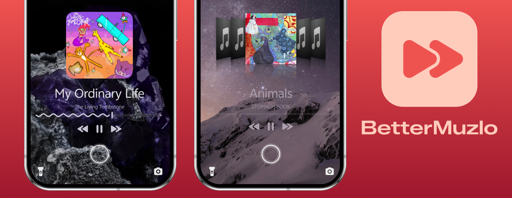

# BetterMuzlo

An LSPosed module for OriginOS that brings a customizable lock screen media player with multiple visual styles.

## Build

Requires **JDK 17** and **Android SDK 35** (`ANDROID_HOME` set or `sdk.dir=...` in `local.properties`).

```bash
./gradlew :app:assembleDebug
```

The built APK is located at `app/build/outputs/apk/debug/app-debug.apk`.